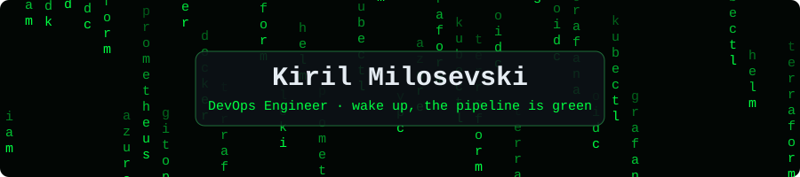

<p align="center">
  
</p>

<p align="center">
  
</p>

<p align="center">
  
</p>

# Hi, I'm Kiril

**DevOps Engineer in Skopje** — I design, automate, and operate reliable cloud infrastructure on **AWS** and **Azure**.

I build platforms with Terraform and **AWS CDK**, ship with CI/CD and GitOps, and care about observability, security gates, and removing manual toil.

```hcl
resource "engineer" "kiril" {
  name     = "Kiril Milosevski"
  role     = "DevOps Engineer"
  location = "Skopje, North Macedonia"

  clouds = ["aws", "azure"]
  iac    = ["terraform", "aws-cdk"]
  gitops = ["argocd", "github-actions", "gitlab-ci"]

  lifecycle {
    prevent_destroy = true
    ignore_changes  = [sleep_schedule]
  }
}
```

## What I do

- Design and operate AWS and Azure infrastructure for SaaS / platform workloads
- Infrastructure as Code with **Terraform** and **AWS CDK**
- CI/CD with GitHub Actions and GitLab CI (OIDC, image scanning, safe rollouts)
- Containers and orchestration: Docker, ECS, Kubernetes, Helm, Argo CD
- Observability: Grafana, Prometheus, Alloy, Loki, CloudWatch, Datadog
- Networking and access: DNS, VPN, Cloudflare, IAM / managed identities
- Security in the pipeline: Trivy, Gitleaks, least-privilege IAM

## Skills

<p align="center">
  
  
  
  
  
  
  
  
  
  
  
  
  
  
</p>

```text
$ kubectl get skills
NAME             READY   STATUS
terraform        1/1     Running
aws-cdk          1/1     Running
kubernetes       1/1     Running
argocd           1/1     Running
observability    1/1     Running
```

<details>
<summary>Full skills breakdown</summary>

| Category | Tools |
|---|---|
| Cloud | AWS (EC2, ECS, ECR, Lambda, IAM, VPC, CloudFront, WAF, SSM) · Azure (Function Apps, APIM, Front Door, Cosmos DB, Key Vault, Managed Identity, Service Bus) |
| IaC | Terraform, AWS CDK |
| Delivery | Docker, Kubernetes, Helm, Argo CD, GitHub Actions, GitLab CI |
| Observability | Grafana, Prometheus, Alloy, Loki, CloudWatch, Datadog, alerting, incident response |
| Security | Trivy, Gitleaks, OIDC, Keycloak, Sealed Secrets |
| Data | PostgreSQL, Redis/Valkey, SQL migrations |

</details>

## Side projects

- **[Enterprise-k8s-platform](https://github.com/KirilMilosevski/Enterprise-k8s-platform)** — GitOps Kubernetes platform: Terraform, Argo CD, Traefik, cert-manager, observability, Cloudflare tunnel
- **[Homelab](https://github.com/KirilMilosevski/Homelab)** — Archived early lab (superseded by Enterprise-k8s-platform)

<p>
  
  <a href="https://github.com/KirilMilosevski/Enterprise-k8s-platform/actions/workflows/main-ci.yml"></a>
</p>

## Links

- Portfolio: [kirilmilosevski.github.io/kiril-cv-landing](https://kirilmilosevski.github.io/kiril-cv-landing/)
- LinkedIn: [kiril-milosevski](https://www.linkedin.com/in/kiril-milosevski-603b25241)
